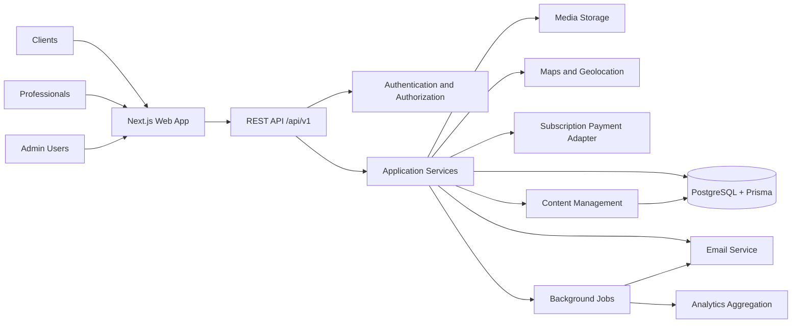
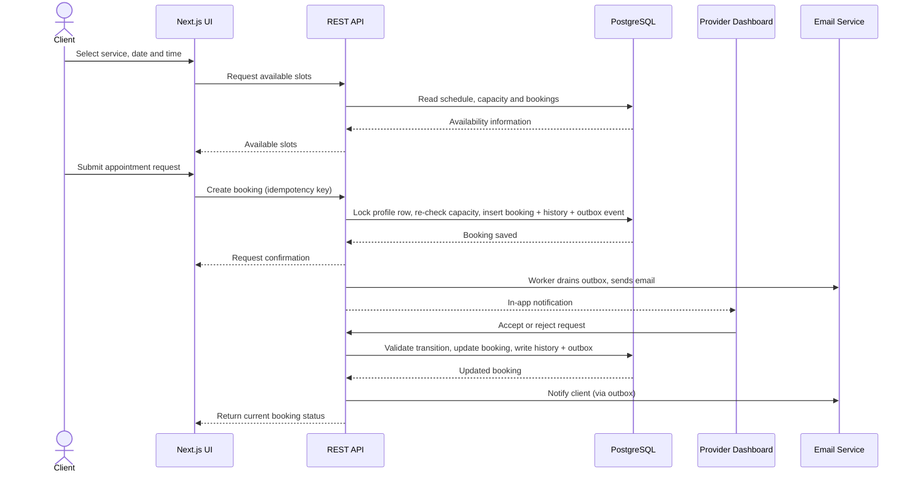
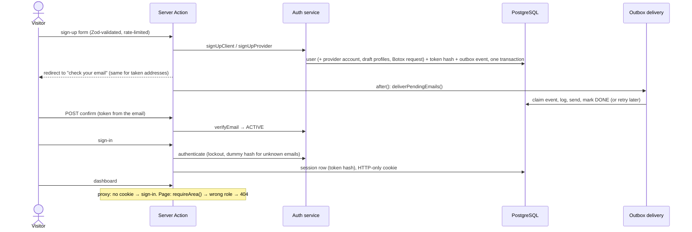

# Architecture

## System



## Stack (as installed)

| Layer | Choice | Notes |
|---|---|---|
| Framework | Next.js 16.4 App Router, React 19.3, TypeScript strict | `cacheComponents` on: request-time data sits behind `Suspense` + `connection()`; public data uses `"use cache"` with `cacheLife` and `cacheTag`. |
| Styling | Tailwind CSS v4 via `@tailwindcss/turbopack` | Tokens in `src/app/globals.css` (`@theme`), see [DESIGN.md](DESIGN.md). |
| Motion | `motion` 12 (`motion/react`) | Scroll-linked values only through `useScroll`/`useTransform`; no scroll listeners. |
| Icons | `lucide-react` | Requested by the owner. |
| Forms | React Hook Form + Zod | Zod schemas are shared by client forms and API handlers. |
| Database | PostgreSQL 17, Prisma 7.10 (`prisma-client` generator, `@prisma/adapter-pg`) | Client generated to `src/generated/prisma` (git-ignored). Config in `prisma.config.ts`. |
| Tests | Vitest (unit/integration), Playwright (E2E, visual) | |
| i18n | Native dictionaries (`src/i18n`), `[locale]` root segment, `proxy.ts` redirect | French LTR, Arabic RTL, `Africa/Algiers`, DZD. |

## Code layout

```text
src/
  app/[locale]/        pages (root layout sets lang/dir and fonts)
  app/api/v1/          route handlers: parse + authorize + call a service, nothing else
  components/          layout/, marketing/, ui/ (dashboard/, booking/ as they arrive)
  config/              static presentation data (category art, wilayas)
  i18n/                locale config and dictionaries
  lib/                 db client, formatting, storage URLs, (auth, email, payments adapters)
  server/services/     business logic (discovery, bookings, schedules, billing, …)
  server/policies/     authorization rules, one function per resource action
  proxy.ts             locale redirect (optimistic checks only, never authorization)
prisma/                schema, migrations, seed
docs/                  this documentation
scripts/               visual-QA helpers
```

Rules:

1. Route handlers stay thin: validate with Zod, resolve the session, call a policy, call a service.
2. Services never trust IDs from the browser for ownership; they load the resource and check the policy.
3. Anything with money, capacity or status changes runs in a database transaction.
4. Side effects (email, analytics) go through the transactional outbox, so a failed email never rolls back a booking.

## Booking sequence



### Capacity and concurrency (Phase 6, implemented)

- Availability (`src/lib/availability.ts`, pure) = weekly `WorkingSchedule` windows, replaced by an open
  `ScheduleException` or removed by a closed one, on a 15-minute grid, minus starts closer than 2 hours.
  A start is offered while fewer than `capacity` capacity-holding bookings (`PENDING`, `ACCEPTED`,
  `RESCHEDULE_PROPOSED`) overlap `[start, start + duration + buffer)`; each existing booking blocks its own
  `[start, end + buffer)`.
- `requestBooking` (`src/server/services/bookings.ts`) takes `SELECT … FOR UPDATE` on the
  `ProviderServiceProfile` row, recomputes that day's availability inside the transaction and only then
  inserts the booking, its history row, notifications and outbox emails. Simultaneous requests for the
  last place serialize on the lock; the later ones fail with `slot`.
- Pending requests store `pendingExpiresAt` (48 h, or the start time if sooner). The expiry job is not
  written yet, so until then a pending request holds its place until the professional answers.
- Cached availability is display-only. The transaction is the authority.

## Hero film (homepage)

`public/media/hero-woman-cares.mp4` is the owner's four clips (hair, skin care, nails, massage) joined with
0.8 s crossfades (29.6 s, H.264, a keyframe every second so chapter seeks are instant). A 960 px version
serves narrow screens. Chapter start times live in `src/config/categories.ts`; if the film is replaced,
update `filmChapterStart`, `HERO_FILM_DURATION` and the stills in `public/images/hero/`.

Regenerate from the source clips:

```bash
ffmpeg -i hair.mp4 -i skin.mp4 -i nails.mp4 -i massage.mp4 -filter_complex "[0:v]settb=AVTB,fps=24,format=yuv420p[a];[1:v]settb=AVTB,fps=24,format=yuv420p[b];[2:v]settb=AVTB,fps=24,format=yuv420p[c];[3:v]settb=AVTB,fps=24,format=yuv420p[d];[a][b]xfade=transition=fade:duration=0.8:offset=7.2[ab];[ab][c]xfade=transition=fade:duration=0.8:offset=14.4[abc];[abc][d]xfade=transition=fade:duration=0.8:offset=21.6[out]" -map "[out]" -an -c:v libx264 -preset slow -crf 24 -g 24 -keyint_min 24 -sc_threshold 0 -pix_fmt yuv420p -movflags +faststart public/media/hero-woman-cares.mp4
```

## Public pages and directory search (Phase 2)

- Every non-home page renders inside `PageShell` (solid header, footer, shared "Trouver mon soin" dialog).
  The locale comes from `next/root-params`; anything that reads route params or `searchParams` sits inside
  `<Suspense>` so navigations stay instant under Cache Components.
- `searchDirectory()` (`src/server/services/directory.ts`) is one parameterised SQL query: fixed public
  visibility rules, optional filters, review aggregation through a `LATERAL` join, haversine distance from the
  provider's *public* position, `count(*) OVER ()` for pagination. Results are cached for minutes and tagged
  `profiles` / `directory:<category>` so publishing changes can invalidate them.
- Profile and provider pages read through `getPublicProfile()` / `getPublicProvider()`, which select only
  public fields (never the street address, coordinates, credentials or private media).
- Profile views are posted by a client beacon to `POST /api/v1/profiles/{slug}/views` and stored once per
  anonymous visitor per day.
- Integration tests import these services directly against `TEST_DATABASE_URL`; `server-only` and
  `next/cache` are stubbed in `vitest.config.mts`.

## Authentication (Phase 3)



- `src/lib/auth/`: password hashing, tokens, session cookie and `requireUser`/`requireArea`, safe redirects.
- `src/server/policies/roles.ts`: every permission decision, as pure functions.
- Session reads happen inside `<Suspense>` and call `connection()`, so they never run during prerendering;
  the header receives the account control as a server-rendered slot.


## Dashboard navigation speed (2026-10-17)

Dashboard pages do **not** wrap their content in their own `<Suspense>` skeleton. They render inside
the dashboard layout's boundary, so a click keeps the current page on screen until the next one is
ready (about 120-150 ms in production) and then swaps in one step. A page-level skeleton made every
click slower: React shows a fallback for at least 300 ms before revealing content, so navigations took
about 840 ms even though the server answered in under 80 ms. Sidebar links show a thin pending bar
(`useLinkStatus`) only when a navigation lasts longer than 120 ms. In `next dev` each page is compiled
on its first visit (1 to 4 s) and ships unminified JavaScript (about 8 MB); measure speed on
`npm run build && npm start`.
