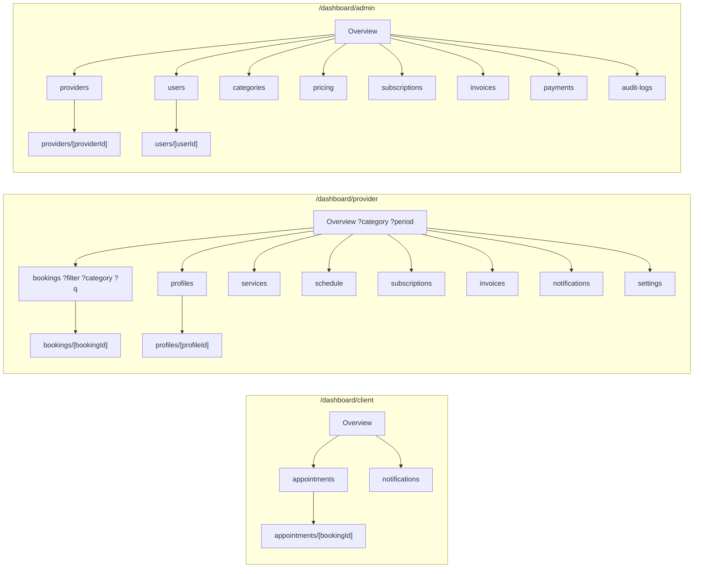

# Dashboard site map

All routes are prefixed with `/{locale}` (`fr` or `ar`). Every page checks the session and the
role on the server (`requireArea`); a wrong role gets the 404 page, a signed-out visitor is sent to
sign-in with the page kept in `?next=`. Only modules marked **Live** appear in the sidebar
(`src/components/dashboard/shell/nav.ts`, `ready` flag).

## Client

| Route | Status | Purpose |
|---|---|---|
| `/dashboard/client` | Live | Stats (upcoming, awaiting, completed, favorites), proposals to answer, next appointments, favorites, latest notifications |
| `/dashboard/client/appointments` | Live | Table with filters upcoming / pending / past / all, pagination |
| `/dashboard/client/appointments/[bookingId]` | Live | Details, history, cancel, answer a proposed time, review a completed visit |
| `/dashboard/client/notifications` | Live | In-app notifications, mark read |
| `/favorites`, `/reviews`, `/profile`, `/support` | Planned | Hidden from the sidebar until built |

## Professional

| Route | Status | Purpose |
|---|---|---|
| `/dashboard/provider` | Live | Category switcher, period, stats, 8-week chart, next appointments, activity, profiles, subscription |
| `/dashboard/provider/bookings` | Live | Operational table: to handle, today, upcoming, past, cancelled, all; category; search by client or reference |
| `/dashboard/provider/bookings/[bookingId]` | Live | Accept/decline, propose a time (free slots only), cancel with reason, complete, no-show, record payments and refunds, history, client review |
| `/profiles`, `/profiles/[profileId]`, `/services`, `/schedule`, `/settings` | Live | Profile editor, services, hours and closures, business settings |
| `/subscriptions`, `/invoices` | Live | Subscription status, billable categories, invoices, payment declaration |
| `/notifications` | Live | In-app notifications |
| `/calendar`, `/earnings`, `/analytics`, `/support` | Planned | Hidden from the sidebar until built |

## Administration (SUPPORT, ADMIN, SUPER_ADMIN)

| Route | Status | Purpose |
|---|---|---|
| `/dashboard/admin` | Live | Platform stats, 8-week chart, review queue, recent audit activity |
| `/providers`, `/providers/[providerId]` | Live | Review queue and professional file, including **Prix de l’abonnement** (standard, agreed monthly price, exemption) |
| `/users`, `/users/[userId]` | Live | Accounts, roles, status |
| `/categories`, `/pricing` | Live | Category order and activation, dated price history |
| `/subscriptions`, `/invoices`, `/payments` | Live | Billing overview, invoices, payment verification, billing cycle |
| `/audit-logs` | Live (ADMIN+) | Filtered audit log |
| `/bookings`, `/content`, `/moderation`, `/support`, `/analytics`, `/settings` | Planned | Hidden from the sidebar until built |
