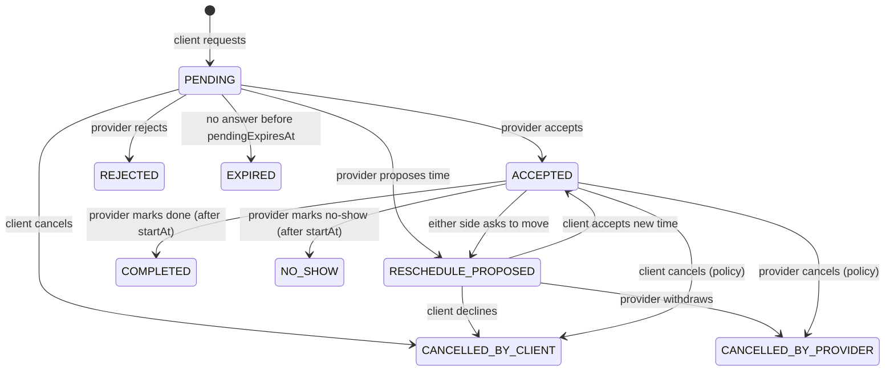

# Database ERD

Source of truth: [`prisma/schema.prisma`](../prisma/schema.prisma). Migration:
`prisma/migrations/*_init` (adds CHECK constraints and partial unique indexes that Prisma cannot express).
Owner's reference diagram: [assets/erd-reference.webp](assets/erd-reference.webp).

## Conventions

- UUID keys; `timestamptz` stored in UTC, displayed in `Africa/Algiers`.
- Money: `Decimal(12,2)` in DZD.
- Schedules: minutes from local midnight (`startMinute`, `endMinute`), weekday 0 = Sunday.
- Nothing financial or historical is hard-deleted; bookings and invoices keep snapshots of names and prices.
- Two money systems never mix: `BookingPayment` (client → professional) and `SubscriptionPayment` (professional → Woman Cares).

## Core relationships

```mermaid
classDiagram
    class User { UUID id; String email; String fullName; UserRole role; UserStatus status }
    class ProviderAccount { UUID id; UUID userId; String businessName; ProviderStatus status; LocationVisibility locationVisibility }
    class Category { UUID id; String slug; Boolean active; Boolean requiresCredentialReview }
    class ProviderServiceProfile { UUID id; UUID providerId; UUID categoryId; String slug; Decimal startingPrice; ProfileStatus status; Boolean billingVisible }
    class ProviderService { UUID id; UUID profileId; String name; Int durationMinutes; Int bufferMinutes; Decimal priceMin; Decimal priceMax; Boolean active }
    class PortfolioMedia { UUID id; UUID profileId; MediaType type; String storageKey; Boolean isCardImage; Boolean isCover }
    class WorkingSchedule { UUID id; UUID profileId; Int weekday; Int startMinute; Int endMinute; Int capacity }
    class ScheduleException { UUID id; UUID profileId; Date date; Boolean isClosed }
    class ProviderCredential { UUID id; UUID providerId; String storageKey; VerificationStatus status }
    class ProviderCategoryRequest { UUID id; UUID providerId; UUID categoryId; RequestStatus status }
    class Booking { UUID id; String reference; UUID clientId; UUID profileId; UUID serviceId; DateTime startAt; DateTime endAt; BookingStatus status; PaymentStatus paymentStatus; Decimal priceMinSnap }
    class BookingStatusHistory { UUID id; UUID bookingId; BookingStatus fromStatus; BookingStatus toStatus; UUID actorId }
    class BookingReferenceMedia { UUID id; UUID bookingId; String storageKey }
    class BookingPayment { UUID id; UUID bookingId; Decimal amount; PaymentStatus status }
    class ProviderSubscription { UUID id; UUID providerId; SubscriptionStatus status; BillingBasis billingBasis; DateTime trialEndsAt; DateTime currentPeriodEnd; DateTime graceEndsAt }
    class SubscriptionItem { UUID id; UUID subscriptionId; UUID categoryId; Decimal priceSnapshot }
    class CategorySubscriptionPricing { UUID id; UUID categoryId; Decimal monthlyPrice; DateTime effectiveFrom }
    class Invoice { UUID id; String number; Decimal total; InvoiceStatus status; Json pricingBasisSnapshot }
    class SubscriptionPayment { UUID id; UUID invoiceId; Decimal amount; PaymentStatus status; String idempotencyKey }
    class Review { UUID id; UUID bookingId; UUID clientId; UUID profileId; Int rating }
    class Favorite { UUID clientId; UUID profileId }
    class Notification { UUID id; UUID userId; String type; DateTime readAt }
    class OutboxEvent { UUID id; String type; OutboxStatus status; Int attempts }
    class EmailDeliveryLog { UUID id; String dedupeKey; EmailStatus status }
    class ProfileViewEvent { BigInt id; UUID profileId; String visitorHash; Date day }
    class AuditLog { UUID id; UUID actorId; String action; String entityType; String entityId }
    class ContentPage { UUID id; String slug; String locale; ContentStatus status }
    class ContentSection { UUID id; UUID pageId; String key; Int sortOrder; Boolean visible }

    User "1" --> "0..1" ProviderAccount : owns
    ProviderAccount "1" --> "0..*" ProviderServiceProfile : publishes (one per category)
    Category "1" --> "0..*" ProviderServiceProfile : classifies
    ProviderAccount "1" --> "0..*" ProviderCategoryRequest : requests categories
    ProviderAccount "1" --> "0..*" ProviderCredential : submits
    ProviderServiceProfile "1" --> "0..*" ProviderService : offers
    ProviderServiceProfile "1" --> "0..*" PortfolioMedia : displays
    ProviderServiceProfile "1" --> "0..*" WorkingSchedule : schedules
    ProviderServiceProfile "1" --> "0..*" ScheduleException : overrides
    User "1" --> "0..*" Booking : requests
    ProviderServiceProfile "1" --> "0..*" Booking : receives
    ProviderService "1" --> "0..*" Booking : selected service
    Booking "1" --> "0..*" BookingStatusHistory : records
    Booking "1" --> "0..*" BookingReferenceMedia : private references
    Booking "1" --> "0..*" BookingPayment : service payments
    Booking "1" --> "0..1" Review : eligible review
    ProviderAccount "1" --> "0..*" ProviderSubscription : subscribes
    ProviderSubscription "1" --> "0..*" SubscriptionItem : covers categories
    Category "1" --> "0..*" CategorySubscriptionPricing : price history
    ProviderSubscription "1" --> "0..*" Invoice : bills
    Invoice "1" --> "0..*" SubscriptionPayment : payments
    User "1" --> "0..*" Favorite : saves
    ProviderServiceProfile "1" --> "0..*" Favorite : is saved
    User "1" --> "0..*" Notification : receives
    OutboxEvent "1" --> "0..*" EmailDeliveryLog : delivers
    ProviderServiceProfile "1" --> "0..*" ProfileViewEvent : visits
    User "1" --> "0..*" AuditLog : acts
    ContentPage "1" --> "0..*" ContentSection : contains
```

Supporting tables not drawn: `Session`, `VerificationToken`, `NotificationPreference`, `Wilaya`, `Commune`,
`SubscriptionPlan`, `InvoiceLine`, `PaymentEvent`, `ReviewReport`, `AnalyticsDailyAggregate`,
`SupportRequest`, `MediaAsset`, `PlatformSetting`, `LegalDocumentVersion`.

## Booking state machine

Every transition writes a `BookingStatusHistory` row and an `OutboxEvent` in the same transaction.
`EXPIRED` was added to the owner's list so unanswered requests release capacity cleanly.

## Integrity rules in SQL

- `Review.rating` between 1 and 5; one review per booking (unique `bookingId`).
- `WorkingSchedule`: weekday 0–6, `0 ≤ start < end ≤ 1440`, `capacity > 0`.
- `ProviderService`: duration > 0, `priceMax ≥ priceMin`.
- `Booking.endAt > startAt`; payments ≥ 0.
- At most one card image and one cover per profile (partial unique indexes).
- `ProfileViewEvent` unique per (profile, visitor hash, day), so refreshes never inflate unique visitors.

## Seed

`npx prisma db seed` inserts reference data only: 58 wilayas, six categories, default pricing
(30 000 DZD per category per month, editable), the per-category plan and platform settings.
It never creates professionals, reviews or bookings.
