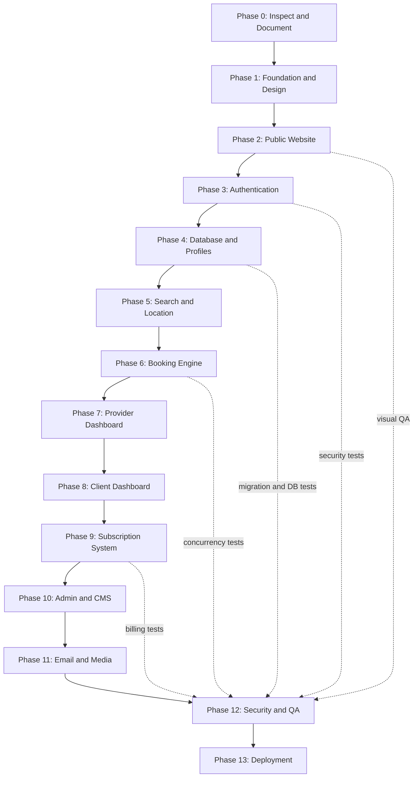

# Roadmap

Status is updated at the end of every working session. "Done" means implemented **and** verified
(type check, lint, and the checks listed). Nothing is marked done because a page merely renders.

Reference image supplied by the owner: [assets/roadmap-reference.webp](assets/roadmap-reference.webp).

## Status

| Phase | Scope | Status |
|---|---|---|
| 0 | Repo inspection, docs, diagrams | **Done** (2026-10-16). Greenfield folder; docs in `docs/`. |
| 1 | Next.js 16 + TS strict, Tailwind v4, FR/AR i18n with RTL, design tokens, fonts, header/footer | **Done**. Verified with `tsc`, ESLint, Playwright screenshots at 375/768/1440, FR and AR. |
| 2 | Public website | **Done** (2026-10-16). Homepage; six category directories with server-side filters, URL state and pagination; category profile pages; provider identity pages; about-platform; about-services (live pricing from the DB); contact (stores `SupportRequest`); privacy and terms (provisional drafts with a visible notice). Verified: 19 unit + 12 integration tests, production build, screenshots FR/AR at 375/768/1440, contact and filter forms exercised in a browser. Sign-in/sign-up arrived with Phase 3. |
| 3 | Authentication and permissions | **Done** (2026-10-16). Client and professional sign-up (one account, a DRAFT profile per category, a pending request for Botox), sign-in with lockout and rate limits, database sessions in an HTTP-only cookie, sign-out, email verification (POST confirmation), password reset (single-use, revokes all sessions, security notice), server-side role policies, role-guarded dashboards (minimal live overviews), audited role/status changes, Super Admin CLI, email outbox with retries. Verified: 49 unit, 29 integration, 8 end-to-end tests (production build on the test database), browser walkthrough of every flow. |
| 4 | Database and multi-category profiles | **Done** (2026-10-16). Schema, migration and seeds; professional space with one editor per category profile: presentation (specialties from the category vocabulary, declared hygiene/products, cancellation policy, vetted social links), services (durations, buffers, price ranges, automatic starting price, history-safe deletion), portfolio (sniffed uploads, images re-encoded to WebP with metadata/GPS stripped, video container checks, ordering, card image), weekly schedule (split shifts, capacity, conflict check against future bookings) and closures; business settings (public phone, private address, location visibility, opt-in coordinates); add/archive categories (Botox via request); submission checklist and DRAFT → PENDING_REVIEW. Verified: 63 unit, 43 integration, 10 end-to-end tests; browser walkthrough; FR/AR at 375/768/1440. |
| 5 | Search, filters, geolocation | **Mostly done** (ahead of schedule, with Phase 2). Filters: wilaya, commune, keyword (name, headline, specialties, service names), specialty, open on a date, price range, experience, minimum rating, verified, distance with opt-in geolocation and max distance; sorts: relevance, distance, price, rating. Remaining: full commune dataset import (only a few demo communes exist), slot-level date/time availability (needs Phase 6), `GET /api/v1/profiles`. |
| 6 | Booking and schedule engine | Not started. |
| 7 | Provider dashboard | Not started. Profile view events are already recorded (privacy-conscious, one per visitor per day). |
| 8 | Client dashboard | Not started. |
| 9 | Subscriptions and payments | Not started (tables exist). |
| 10 | Admin dashboard and CMS | **Started** (2026-10-16): provider review queue. Queue with filters (to review, approved, suspended, rejected, all), search and pagination; one review page per professional (account, private address, profiles with services/media/hours, category requests, credentials, last 30 audit entries). Decisions (ADMIN+; SUPPORT reads only): publish a profile (re-checks completeness, owner account and, for Botox, an approved unexpired credential; approves the account on first publication), request changes (note, back to DRAFT), suspend/reinstate a profile, approve/reject/suspend/reinstate an account, verified badge on/off, accept/reject category requests (accepting creates a DRAFT profile), validate/reject credentials. Every decision is transactional, audited, notifies the professional in-app and by email (her language), and invalidates the public cache. Botox credential upload: PDF or photo into private storage, opened by ADMIN+ only, each opening audited. Verified: 66 unit, 57 integration, 12 end-to-end tests; FR/AR at 375/768/1440. Remaining: users, categories, pricing, subscriptions, payments, CMS, moderation of reviews, analytics, audit browser, settings. |
| 11 | Email, media, background jobs | **Started.** Outbox, SMTP/log transports, delivery log, retries, worker, 4 auth templates. Media: storage adapter (local driver; public and private roots), `/uploads/*` route, upload pipeline. Remaining: S3-compatible driver, video transcoding/poster frames, booking/subscription email templates. |
| 12 | Security and QA | Ongoing per phase. |
| 13 | Deployment | Not started. |

## Next session

1. Phase 6: booking engine (slot generation from the weekly hours, closures and capacity; transactional booking requests with concurrency tests); then the profile page's booking panel goes live.
3. Phase 5 remainder: import the full commune dataset with coordinates.
4. Phase 10 next slices: user management screen, category and pricing management, audit log browser.

## Known limitations

- The profile page's booking panel says online requests open soon and shows the public phone when provided; real requests arrive with Phase 6.
- Rate limiting (contact, sign-up, sign-in, reset) is in-memory: correct for one instance; production with several instances needs a shared store.
- Client and admin dashboards are minimal live overviews; their tools arrive in Phases 7, 8 and 10.
- Only the local storage driver exists; `STORAGE_DRIVER=s3` fails loudly until the S3 driver is written. Videos are stored as uploaded (container checked, not transcoded).
- Credentials are not re-checked when they expire after publication: a published Botox profile stays visible until staff suspend it. An expiry job belongs with Phase 11 background jobs.
- The review queue uses Server Actions; the `/api/v1/admin/providers` REST routes are not written yet (only the credential file route exists).
- A "not found" inside a streamed section (unknown profile, wrong dashboard role) shows the 404 page with `noindex` but an HTTP 200 status.
- Emails use the `log` transport locally (printed to the server console). Real delivery needs SMTP credentials plus SPF/DKIM/DMARC, then a delivery test.
- In development, Next.js may flag the profile gallery's first image as LCP without `loading="eager"`: the large image is eager; the warning comes from its small thumbnail sharing the same URL.
- Demo data (`npm run db:seed:demo`) exists only for local development; every business is labelled "Démo" and it creates no reviews or bookings.
