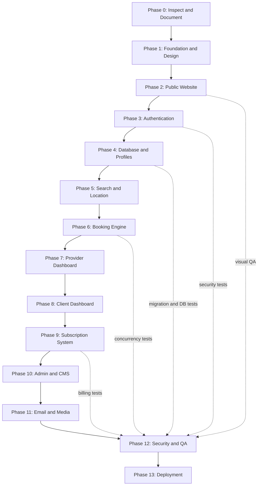

# Roadmap

Status is updated at the end of every working session. "Done" means implemented **and** verified
(type check, lint, and the checks listed). Nothing is marked done because a page merely renders.

Reference image supplied by the owner: [assets/roadmap-reference.webp](assets/roadmap-reference.webp).

## Status

| Phase | Scope | Status |
|---|---|---|
| 0 | Repo inspection, docs, diagrams | **Done** (2026-10-16). Greenfield folder; docs in `docs/`. |
| 1 | Next.js 16 + TS strict, Tailwind v4, FR/AR i18n with RTL, design tokens, fonts, header/footer | **Done**. Verified with `tsc`, ESLint, Playwright screenshots at 375/768/1440, FR and AR. |
| 2 | Public website | **Done** (2026-10-16). Homepage; six category directories with server-side filters, URL state and pagination; category profile pages; provider identity pages; about-platform; about-services (live pricing from the DB); contact (stores `SupportRequest`); privacy and terms (provisional drafts with a visible notice). Verified: 19 unit + 12 integration tests, production build, screenshots FR/AR at 375/768/1440, contact and filter forms exercised in a browser. Sign-in/sign-up arrived with Phase 3. |
| 3 | Authentication and permissions | **Done** (2026-10-16). Client and professional sign-up (one account, a DRAFT profile per category, a pending request for Botox), sign-in with lockout and rate limits, database sessions in an HTTP-only cookie, sign-out, email verification (POST confirmation), password reset (single-use, revokes all sessions, security notice), server-side role policies, role-guarded dashboards (minimal live overviews), audited role/status changes, Super Admin CLI, email outbox with retries. Verified: 49 unit, 29 integration, 8 end-to-end tests (production build on the test database), browser walkthrough of every flow. |
| 4 | Database and multi-category profiles | **Partly done.** Full Prisma schema, initial migration (with CHECK constraints and partial unique indexes), reference seed (58 wilayas, 6 categories, default pricing 30 000 DZD, plan, settings). Remaining: repositories/services, provider onboarding, media upload. |
| 5 | Search, filters, geolocation | **Mostly done** (ahead of schedule, with Phase 2). Filters: wilaya, commune, keyword (name, headline, specialties, service names), specialty, open on a date, price range, experience, minimum rating, verified, distance with opt-in geolocation and max distance; sorts: relevance, distance, price, rating. Remaining: full commune dataset import (only a few demo communes exist), slot-level date/time availability (needs Phase 6), `GET /api/v1/profiles`. |
| 6 | Booking and schedule engine | Not started. |
| 7 | Provider dashboard | Not started. Profile view events are already recorded (privacy-conscious, one per visitor per day). |
| 8 | Client dashboard | Not started. |
| 9 | Subscriptions and payments | Not started (tables exist). |
| 10 | Admin dashboard and CMS | Not started (tables exist). |
| 11 | Email, media, background jobs | **Started.** Transactional outbox, SMTP/log transports, delivery log with de-duplication, retries with backoff, `npm run outbox:deliver` worker, 4 auth templates (FR/AR, HTML + text). Remaining: booking/subscription templates, media storage and upload pipeline. |
| 12 | Security and QA | Ongoing per phase. |
| 13 | Deployment | Not started. |

## Next session

1. Phase 4: provider profile editor (services, prices, durations, portfolio upload with validation and private/public storage, weekly schedule), submit for review; adding/removing categories from Settings.
2. Phase 6: booking engine (slot generation + transactional capacity checks) with unit and concurrency tests; then the profile page's booking panel goes live.
3. Phase 10 (first slice): admin review queue to approve providers, profiles and Botox credentials, using the policies and audit log already in place.

## Known limitations

- The profile page's booking panel says online requests open soon and shows the public phone when provided; real requests arrive with Phase 6.
- Rate limiting (contact, sign-up, sign-in, reset) is in-memory: correct for one instance; production with several instances needs a shared store.
- Dashboards are minimal live overviews; their tools arrive in Phases 4, 7, 8 and 10.
- A "not found" inside a streamed section (unknown profile, wrong dashboard role) shows the 404 page with `noindex` but an HTTP 200 status.
- Emails use the `log` transport locally (printed to the server console). Real delivery needs SMTP credentials plus SPF/DKIM/DMARC, then a delivery test.
- In development, Next.js may flag the profile gallery's first image as LCP without `loading="eager"`: the large image is eager; the warning comes from its small thumbnail sharing the same URL.
- Demo data (`npm run db:seed:demo`) exists only for local development; every business is labelled "Démo" and it creates no reviews or bookings.
