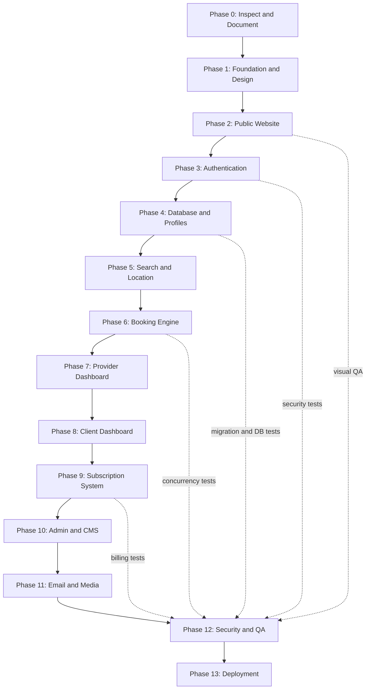

# Roadmap

Status is updated at the end of every working session. "Done" means implemented **and** verified
(type check, lint, and the checks listed). Nothing is marked done because a page merely renders.

Reference image supplied by the owner: [assets/roadmap-reference.webp](assets/roadmap-reference.webp).

## Status

| Phase | Scope | Status |
|---|---|---|
| 0 | Repo inspection, docs, diagrams | **Done** (2026-10-16). Greenfield folder; docs in `docs/`. |
| 1 | Next.js 16 + TS strict, Tailwind v4, FR/AR i18n with RTL, design tokens, fonts, header/footer | **Done**. Verified with `tsc`, ESLint, Playwright screenshots at 375/768/1440, FR and AR. |
| 2 | Public website | **Done** (2026-10-16). Homepage; six category directories with server-side filters, URL state and pagination; category profile pages; provider identity pages; about-platform; about-services (live pricing from the DB); contact (stores `SupportRequest`); privacy and terms (provisional drafts with a visible notice). Verified: 19 unit + 12 integration tests, production build, screenshots FR/AR at 375/768/1440, contact and filter forms exercised in a browser. Sign-in/sign-up arrived with Phase 3. |
| 3 | Authentication and permissions | **Done** (2026-10-16). Client and professional sign-up (one account, a DRAFT profile per category, a pending request for Botox), sign-in with lockout and rate limits, database sessions in an HTTP-only cookie, sign-out, email verification (POST confirmation), password reset (single-use, revokes all sessions, security notice), server-side role policies, role-guarded dashboards (minimal live overviews), audited role/status changes, Super Admin CLI, email outbox with retries. Verified: 49 unit, 29 integration, 8 end-to-end tests (production build on the test database), browser walkthrough of every flow. |
| 4 | Database and multi-category profiles | **Done** (2026-10-16). Schema, migration and seeds; professional space with one editor per category profile: presentation (specialties from the category vocabulary, declared hygiene/products, cancellation policy, vetted social links), services (durations, buffers, price ranges, automatic starting price, history-safe deletion), portfolio (sniffed uploads, images re-encoded to WebP with metadata/GPS stripped, video container checks, ordering, card image), weekly schedule (split shifts, capacity, conflict check against future bookings) and closures; business settings (public phone, private address, location visibility, opt-in coordinates); add/archive categories (Botox via request); submission checklist and DRAFT → PENDING_REVIEW. Verified: 63 unit, 43 integration, 10 end-to-end tests; browser walkthrough; FR/AR at 375/768/1440. |
| 5 | Search, filters, geolocation | **Mostly done** (ahead of schedule, with Phase 2). Filters: wilaya, commune, keyword (name, headline, specialties, service names), specialty, open on a date, price range, experience, minimum rating, verified, distance with opt-in geolocation and max distance; sorts: relevance, distance, price, rating. Remaining: full commune dataset import (only a few demo communes exist), slot-level date/time availability (needs Phase 6), `GET /api/v1/profiles`. |
| 6 | Booking and schedule engine | **Core done** (2026-10-16). Slot generation (`src/lib/availability.ts`: weekly hours, open/closed exceptions, 15-minute grid, durations, buffers, capacity, 2-hour notice, Algiers time); public availability API; booking requests as a Server Action under a row lock with capacity recount, idempotency key and a 5-open-requests cap; status history, notifications and emails (provider request, client receipt, decision); professional “Demandes” page (accept/decline with a message); client list in her space. Verified: unit (slots), integration (incl. 5 clients racing for 2 places), end-to-end (guest picks a time, signs in, choice restored, sends; professional accepts; client sees “Confirmé”). **Lifecycle done (2026-10-17):** client cancellation before the start; professional cancellation with a required reason; reschedule proposals on free slots only (profile lock, proposed slot held until the client answers, accept moves the appointment, decline returns to the previous state); completion and no-show after the start; payments and refunds recorded by the professional (refund capped at the net paid; Woman Cares takes no payment); one review per completed visit; expiry of unanswered requests in `npm run daily`; three new email templates (FR/AR). Rules shared by UI and server in `src/lib/booking-rules.ts`. Verified: unit booking-rules, integration booking-lifecycle (11 tests), e2e booking (accept, then client cancels). Remaining: private reference photo, calendar view. |
| 7 | Provider dashboard | **In progress** (2026-10-17). Black app shell (sidebar, badges, notifications, account menu) for all three areas; overview with category switcher and period (bookings, requests, recorded revenue, views, conversion, 8-week chart, next appointments, activity, profiles, pending category requests, subscription); operational bookings table (to handle, today, upcoming, past, cancelled, all; category; search; pagination) and booking detail with every action; notifications. **Calendar, earnings and analytics (2026-10-17):** week time grid (agenda on phones) with opening hours, closures and overlapping appointments side by side; earnings from recorded payments (net of refunds) with 12-month chart, by category, by method and unpaid visits; analytics with rates shown only when there is data, funnel, 12-week chart, top services, busy weekdays and hours, per-category table. Verified: unit insights, integration provider-insights, screenshots FR/AR at 375/768/1440 with no overflow. Remaining: support requests (including promotional requests). |
| 8 | Client dashboard | **In progress** (2026-10-17). Overview (stats, proposals to answer, upcoming, awaiting, favorites, notifications); *Mes rendez-vous* with filters and detail (cancel, answer a proposal, review); notifications. Remaining: favorites page and add/remove on profiles, reviews list, profile and settings, support. |
| 9 | Subscriptions and payments | **Core done** (2026-10-17). Billing engine: free trial on approval, per-category standard price from the dated price history, **per-professional agreed monthly price** or exemption set by an admin (audited, applies to the next invoice), invoices unique per period, manual payment declaration and admin verification, grace then expiry hiding profiles, idempotent cycle (`npm run billing:cycle`, also in `npm run daily`), six email templates. Verified: unit + integration billing, e2e billing (admin sets an agreed price). Remaining: packages and promotional prices UI, online payment gateway (not integrated, not claimed). |
| 10 | Admin dashboard and CMS | **Started** (2026-10-16): provider review queue. Queue with filters (to review, approved, suspended, rejected, all), search and pagination; one review page per professional (account, private address, profiles with services/media/hours, category requests, credentials, last 30 audit entries). Decisions (ADMIN+; SUPPORT reads only): publish a profile (re-checks completeness, owner account and, for Botox, an approved unexpired credential; approves the account on first publication), request changes (note, back to DRAFT), suspend/reinstate a profile, approve/reject/suspend/reinstate an account, verified badge on/off, accept/reject category requests (accepting creates a DRAFT profile), validate/reject credentials. Every decision is transactional, audited, notifies the professional in-app and by email (her language), and invalidates the public cache. Botox credential upload: PDF or photo into private storage, opened by ADMIN+ only, each opening audited. Verified: 66 unit, 57 integration, 12 end-to-end tests; FR/AR at 375/768/1440. **Second slice (2026-10-16):** Users (search by name/email, role tabs, status filter, pagination; account file with sign-in facts, linked professional account and history; role changes and suspend/restore strictly within `canChangeRole`/`canChangeStatus`, sessions revoked, audited; a suspended or demoted professional is hidden from every public query), Categories (order with up/down renumbering under a lock, activate/deactivate hiding all their profiles, credential requirement on/off; audited; caches `profiles`, `pricing`, `directory:<slug>` invalidated), Pricing (current price, next change and full history per category; ADMIN+ adds append-only rows starting tomorrow or later at 00:00 Algiers; same-day entry replaces; public price list now keyed by the Algiers day so it switches at midnight), Audit log (ADMIN+ only; filters by action, author including system, entity type, Algiers date range; 50 per page). SUPPORT reads users, categories and prices; clients and providers get the 404 page. Verified: 81 unit, 84 integration, 15 end-to-end tests; production build; FR/AR at 375/768/1440 with no horizontal overflow. Remaining: subscriptions, payments, CMS, moderation of reviews, analytics, settings, REST routes for the admin services. |
| 11 | Email, media, background jobs | **Started.** Outbox, SMTP/log transports, delivery log, retries, worker, 4 auth templates. Media: storage adapter (local driver; public and private roots), `/uploads/*` route, upload pipeline. Remaining: S3-compatible driver, video transcoding/poster frames, booking/subscription email templates. |
| 12 | Security and QA | Ongoing per phase. |
| 13 | Deployment | Not started. |

## Visual redesign (2026-10-16)

Owner references applied site-wide (see docs/DESIGN.md): floral parchment and blush-roses backdrop, light only, brighter hero film, glass navbar, half-circle dial menu, glossy buttons, soft cards, masked titles, new home sections, Notre histoire, Pour les pros and profile page. Checked at 390/768/1440 in FR and AR with no horizontal overflow; Impeccable critique 25/32 (detector: 0 findings). Follow-up the same day: navbar collapses to floating icons on scroll; profile hours sit under the booking card (compact) and the place card moved to the left column; footer rebuilt (marquee, photo band, glass card); Notre histoire gained the founding story and our commitments; copy no longer promises inspiration photos or reschedule proposals until they exist. Then: navbar without a bar (floating links and round buttons), scroll performance pass (no card blur, sleeping title loops, transform-only animations, brightness baked into the hero video and stills), founding story set directly on the floral page, then moved into sideways-scrolling glass cards (pinned on tablet and desktop, swipe on phones; 60 fps measured).

## Next session

1. Phase 7: support requests (including promotional requests) for professionals.
2. Phase 8: favorites page with add/remove on profiles, reviews list, client profile and settings.
3. Phase 10: admin bookings, review moderation, CMS, support inbox, analytics, platform settings (trial and grace days).
4. Phase 5 remainder: import the full commune dataset with coordinates.

## Known limitations

- `npm run daily` (expiry, billing cycle, emails) must be scheduled by the host; nothing runs it automatically yet.
- Booking tables scroll sideways inside their card on phones (no stacked card layout yet).
- The site is light only (owner decision, 2026-10-16); dark-mode tokens were removed.
- The dev server occasionally serves a stale `globals.css`; deleting `.next/dev` and restarting fixes it. Production builds are unaffected.
- Rate limiting (contact, sign-up, sign-in, reset) is in-memory: correct for one instance; production with several instances needs a shared store. It also trusts the first `X-Forwarded-For` value, so it can be bypassed unless a proxy overwrites that header (see docs/SECURITY.md). The e2e helpers give each test account its own address for that reason.
- Dashboard modules not yet built are hidden from the sidebar (see docs/DASHBOARD_SITE_MAP.md).
- Only the local storage driver exists; `STORAGE_DRIVER=s3` fails loudly until the S3 driver is written. Videos are stored as uploaded (container checked, not transcoded).
- Credentials are not re-checked when they expire after publication: a published Botox profile stays visible until staff suspend it. An expiry job belongs with Phase 11 background jobs.
- The review queue, users, categories and pricing use Server Actions; the `/api/v1/admin/*` REST routes are not written yet (only the credential file route exists).
- A deactivated category still has its public directory URL (it lists nothing) and still appears in the static navigation and sign-up choices (which come from `src/config/categories.ts`); sign-up silently skips it. Turning the credential requirement on does not unpublish profiles already public.
- The category order set in the admin applies to the price list and provider pages; the homepage and menus still use the fixed order in `src/config/categories.ts`.
- A "not found" inside a streamed section (unknown profile, wrong dashboard role) shows the 404 page with `noindex` but an HTTP 200 status.
- Emails use the `log` transport locally (printed to the server console). Real delivery needs SMTP credentials plus SPF/DKIM/DMARC, then a delivery test.
- In development, Next.js may flag the profile gallery's first image as LCP without `loading="eager"`: the large image is eager; the warning comes from its small thumbnail sharing the same URL.
- Demo data (`npm run db:seed:demo`) exists only for local development; every business is labelled "Démo" and it creates no reviews or bookings.
