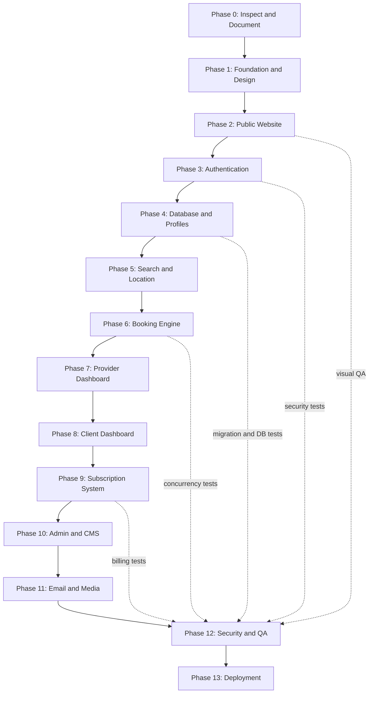

# Roadmap

Status is updated at the end of every working session. "Done" means implemented **and** verified
(type check, lint, and the checks listed). Nothing is marked done because a page merely renders.

Reference image supplied by the owner: [assets/roadmap-reference.webp](assets/roadmap-reference.webp).

## Status

| Phase | Scope | Status |
|---|---|---|
| 0 | Repo inspection, docs, diagrams | **Done** (2026-10-16). Greenfield folder; docs in `docs/`. |
| 1 | Next.js 16 + TS strict, Tailwind v4, FR/AR i18n with RTL, design tokens, fonts, header/footer | **Done**. Verified with `tsc`, ESLint, Playwright screenshots at 375/768/1440, FR and AR. |
| 2 | Public website | **Done** (2026-10-16). Homepage; six category directories with server-side filters, URL state and pagination; category profile pages; provider identity pages; about-platform; about-services (live pricing from the DB); contact (stores `SupportRequest`); privacy and terms (provisional drafts with a visible notice). Verified: 19 unit + 12 integration tests, production build, screenshots FR/AR at 375/768/1440, contact and filter forms exercised in a browser. Sign-in/sign-up arrived with Phase 3. |
| 3 | Authentication and permissions | **Done** (2026-10-16). Client and professional sign-up (one account, a DRAFT profile per category, a pending request for Botox), sign-in with lockout and rate limits, database sessions in an HTTP-only cookie, sign-out, email verification (POST confirmation), password reset (single-use, revokes all sessions, security notice), server-side role policies, role-guarded dashboards (minimal live overviews), audited role/status changes, Super Admin CLI, email outbox with retries. Verified: 49 unit, 29 integration, 8 end-to-end tests (production build on the test database), browser walkthrough of every flow. |
| 4 | Database and multi-category profiles | **Done** (2026-10-16). Schema, migration and seeds; professional space with one editor per category profile: presentation (specialties from the category vocabulary, declared hygiene/products, cancellation policy, vetted social links), services (durations, buffers, price ranges, automatic starting price, history-safe deletion), portfolio (sniffed uploads, images re-encoded to WebP with metadata/GPS stripped, video container checks, ordering, card image), weekly schedule (split shifts, capacity, conflict check against future bookings) and closures; business settings (public phone, private address, location visibility, opt-in coordinates); add/archive categories (Botox via request); submission checklist and DRAFT → PENDING_REVIEW. Verified: 63 unit, 43 integration, 10 end-to-end tests; browser walkthrough; FR/AR at 375/768/1440. |
| 5 | Search, filters, geolocation | **Mostly done** (ahead of schedule, with Phase 2). Filters: wilaya, commune, keyword (name, headline, specialties, service names), specialty, open on a date, price range, experience, minimum rating, verified, distance with opt-in geolocation and max distance; sorts: relevance, distance, price, rating. Remaining: full commune dataset import (only a few demo communes exist), slot-level date/time availability (needs Phase 6), `GET /api/v1/profiles`. |
| 6 | Booking and schedule engine | **Core done** (2026-10-16). Slot generation (`src/lib/availability.ts`: weekly hours, open/closed exceptions, 15-minute grid, durations, buffers, capacity, 2-hour notice, Algiers time); public availability API; booking requests as a Server Action under a row lock with capacity recount, idempotency key and a 5-open-requests cap; status history, notifications and emails (provider request, client receipt, decision); professional “Demandes” page (accept/decline with a message); client list in her space. Verified: unit (slots), integration (incl. 5 clients racing for 2 places), end-to-end (guest picks a time, signs in, choice restored, sends; professional accepts; client sees “Confirmé”). **Lifecycle done (2026-10-17):** client cancellation before the start; professional cancellation with a required reason; reschedule proposals on free slots only (profile lock, proposed slot held until the client answers, accept moves the appointment, decline returns to the previous state); completion and no-show after the start; payments and refunds recorded by the professional (refund capped at the net paid; Woman Cares takes no payment); one review per completed visit; expiry of unanswered requests in `npm run daily`; three new email templates (FR/AR). Rules shared by UI and server in `src/lib/booking-rules.ts`. Verified: unit booking-rules, integration booking-lifecycle (11 tests), e2e booking (accept, then client cancels). Remaining: calendar view (done later, see below). Reference photos: done 2026-10-20. |
| 7 | Provider dashboard | **In progress** (2026-10-17). Black app shell (sidebar, badges, notifications, account menu) for all three areas; overview with category switcher and period (bookings, requests, recorded revenue, views, conversion, 8-week chart, next appointments, activity, profiles, pending category requests, subscription); operational bookings table (to handle, today, upcoming, past, cancelled, all; category; search; pagination) and booking detail with every action; notifications. **Calendar, earnings and analytics (2026-10-17):** week time grid (agenda on phones) with opening hours, closures and overlapping appointments side by side; earnings from recorded payments (net of refunds) with 12-month chart, by category, by method and unpaid visits; analytics with rates shown only when there is data, funnel, 12-week chart, top services, busy weekdays and hours, per-category table. Verified: unit insights, integration provider-insights, screenshots FR/AR at 375/768/1440 with no overflow. Remaining: support requests (including promotional requests). |
| 8 | Client dashboard | **In progress** (2026-10-17). Overview (stats, proposals to answer, upcoming, awaiting, favorites, notifications); *Mes rendez-vous* with filters and detail (cancel, answer a proposal, review); notifications. Remaining: favorites page and add/remove on profiles, reviews list, profile and settings, support. |
| 9 | Subscriptions and payments | **Core done** (2026-10-17). Billing engine: free trial on approval, per-category standard price from the dated price history, **per-professional agreed monthly price** or exemption set by an admin (audited, applies to the next invoice), invoices unique per period, manual payment declaration and admin verification, grace then expiry hiding profiles, idempotent cycle (`npm run billing:cycle`, also in `npm run daily`), six email templates. Verified: unit + integration billing, e2e billing (admin sets an agreed price). Remaining: packages and promotional prices UI, online payment gateway (not integrated, not claimed). |
| 10 | Admin dashboard and CMS | **Started** (2026-10-16): provider review queue. Queue with filters (to review, approved, suspended, rejected, all), search and pagination; one review page per professional (account, private address, profiles with services/media/hours, category requests, credentials, last 30 audit entries). Decisions (ADMIN+; SUPPORT reads only): publish a profile (re-checks completeness, owner account and, for Botox, an approved unexpired credential; approves the account on first publication), request changes (note, back to DRAFT), suspend/reinstate a profile, approve/reject/suspend/reinstate an account, verified badge on/off, accept/reject category requests (accepting creates a DRAFT profile), validate/reject credentials. Every decision is transactional, audited, notifies the professional in-app and by email (her language), and invalidates the public cache. Botox credential upload: PDF or photo into private storage, opened by ADMIN+ only, each opening audited. Verified: 66 unit, 57 integration, 12 end-to-end tests; FR/AR at 375/768/1440. **Second slice (2026-10-16):** Users (search by name/email, role tabs, status filter, pagination; account file with sign-in facts, linked professional account and history; role changes and suspend/restore strictly within `canChangeRole`/`canChangeStatus`, sessions revoked, audited; a suspended or demoted professional is hidden from every public query), Categories (order with up/down renumbering under a lock, activate/deactivate hiding all their profiles, credential requirement on/off; audited; caches `profiles`, `pricing`, `directory:<slug>` invalidated), Pricing (current price, next change and full history per category; ADMIN+ adds append-only rows starting tomorrow or later at 00:00 Algiers; same-day entry replaces; public price list now keyed by the Algiers day so it switches at midnight), Audit log (ADMIN+ only; filters by action, author including system, entity type, Algiers date range; 50 per page). SUPPORT reads users, categories and prices; clients and providers get the 404 page. Verified: 81 unit, 84 integration, 15 end-to-end tests; production build; FR/AR at 375/768/1440 with no horizontal overflow. Remaining: subscriptions, payments, CMS, moderation of reviews, analytics, settings, REST routes for the admin services. |
| 11 | Email, media, background jobs | **Started.** Outbox, SMTP/log transports, delivery log, retries, worker, 4 auth templates. Media: storage adapter (local driver; public and private roots), `/uploads/*` route, upload pipeline. Remaining: S3-compatible driver, video transcoding/poster frames, booking/subscription email templates. |
| 12 | Security and QA | Ongoing per phase. |
| 13 | Deployment | Not started. |

## Visual redesign (2026-10-16)

Owner references applied site-wide (see docs/DESIGN.md): floral parchment and blush-roses backdrop, light only, brighter hero film, glass navbar, half-circle dial menu, glossy buttons, soft cards, masked titles, new home sections, Notre histoire, Pour les pros and profile page. Checked at 390/768/1440 in FR and AR with no horizontal overflow; Impeccable critique 25/32 (detector: 0 findings). Follow-up the same day: navbar collapses to floating icons on scroll; profile hours sit under the booking card (compact) and the place card moved to the left column; footer rebuilt (marquee, photo band, glass card); Notre histoire gained the founding story and our commitments; copy no longer promises inspiration photos or reschedule proposals until they exist. Then: navbar without a bar (floating links and round buttons), scroll performance pass (no card blur, sleeping title loops, transform-only animations, brightness baked into the hero video and stills), founding story set directly on the floral page, then moved into sideways-scrolling glass cards (pinned on tablet and desktop, swipe on phones; 60 fps measured).

## Admin controls (2026-10-17)

Per-professional free trial (any end date, +1/2/3/6 months, or no trial) and a default trial length; prices on any date (in force at once when today or earlier) and deletable rows (never the last); payments recorded with the day they were received; suspension from Utilisateurs now shows under Suspendues and restore returns the previous status; new sign-ups listed under À vérifier, tabs Toutes → Refusées with counts; contact messages page (Super Admin) and staff notifications (new professional, message, declared payment) with email to the Super Admins; revenue cards and 12-month chart on the overview; account settings for every role from the avatar menu; Super Admin deletions across the admin. Verified: 99 unit, 114 integration (11 new), 16 end-to-end; screenshots FR 1440 and AR 375.

## Calendar and profile tools (2026-10-18)

Schedule: same hours for all days in one click, up to 10 ranges a day, session length (15 to 120 min) that drives the calendar grid and the public start times. Calendar: add an appointment by hand (client name and phone, any hour, overnight), click a free session, phone agenda with an add link per day. Bookings: move to any day or hour directly and set an agreed price (client told), edit a manual client. Profile: own specialties, typed "à partir de" price, WhatsApp, contact email, Google Maps link with the map card, profile picture for every user. Admin: target rates for statistics (Super Admin), receipts and period paid on accepted payments, email confirmed by hand, billing shortcut per professional. Phone/tablet sidebar fixed. Verified: 99 unit, 123 integration (9 new), 16 end-to-end; walkthrough data in the dev database (Démo · Salon Lina and Cliente Test, logins in `.env`).

## Calendar sessions, places and booking actions (2026-10-18)

Session length typed by hand (5 to 240 min; empty means 15-minute start times on the site). The calendar is a table of sessions for one category at a time (no "all categories"): sessions start at opening and the last one ends at closing; appointments show as a compact chip opened on click; each open session has a "+" in its top-right corner and counts places against the professional's postes, so a full session cannot take a manual booking or a booking from the site; online clients show with their account name and phone. Add form: free-text "Prestation" with her services suggested. Specialties: create chips instead of typing a list. Rendez-vous: tabs Tous / Aujourd’hui / À venir / Passés / Annulés et refusés (À traiter removed, pending requests sit in À venir), and accept, refuse, cancel with reason or delete (manual, refused, cancelled or expired bookings) straight from the table. Fixed a time-zone drift: the database session now always runs in UTC (`-c TimeZone=UTC`), dev data written while the dev database was set to Africa/Algiers was moved by one hour, and a regression test sets that zone on purpose. Verified: 99 unit, 127 integration, 16 end-to-end, build; screenshots FR 1440/375 and AR 1440/768/375.

## Booking confirmation and back links (2026-10-18)

Booking panel: a professional or admin session now gets an explanation and a "Se connecter avec un compte cliente" button (signs out, returns to the profile, keeps the chosen time); after sending, the client sees the service, day, time, reference and status with a link to the new appointment. Back links (admin professional and account details, professional profile editor and booking detail, client appointment detail, public profile) return to the page actually visited before, with its tab, filters and page; opened directly, they fall back to the list. Verified: 99 unit, 127 integration, 16 end-to-end (booking test extended), build; screenshots FR 1440 and AR 375.

## E-mail confirmation not required to book (2026-10-18)

Owner decision: clients can request appointments before confirming their e-mail. One switch, `BOOKING_REQUIRES_VERIFIED_EMAIL` in src/server/policies/roles.ts (false), controls both the server rule and the booking action; suspended or deactivated accounts still cannot book. The confirmation e-mail and the dashboard reminder are unchanged. Verified: 99 unit, 127 integration, 16 end-to-end, build.

## Inspiration photos, payments by Super Admin only, full QA pass (2026-10-20)

- Every booking, in every category, lets the client describe what she wants (up to 1000 characters, 5-line box) and attach up to 4 example photos (JPEG, PNG or WebP, 10 MB each). Photos are re-encoded to WebP (metadata removed), kept in private storage under `bookings/{bookingId}/`, and shown on the client's and the professional's appointment pages. Only the booking's client, her professional and verified staff can read them (`/api/v1/bookings/{id}/references/{mediaId}`, never cached). The request is sent first, then the photos; a failed photo never loses the request.
- Confirming, refusing, recording and deleting subscription payments is reserved for the Super Admin (`canVerifyPayment`). A failed payment whose invoice is still unpaid shows the "record a payment" form in place.
- QA pass: unit 100, integration 132 (incl. 5 new for photos), end-to-end 16 (booking test now attaches and reads back a photo), and a crawl of 108 pages (public, client, provider and admin; FR and AR; 375/768/1440 widths) with no console errors, crashes or horizontal overflow after two layout fixes (profile editor tab bar, long unbroken text on the admin provider page).

## Sign-in and sign-up, cinematic hero (2026-10-21)

- Sign-in: two pills on top ("Entrer dans mon compte" and "Créer un compte"); the second opens "Je suis une cliente" and "Je suis professionnelle". The sign-up tab "Je cherche un soin" is now "Je suis une cliente" (FR and AR). New sign-in picture: the owner's nail-studio photo, with the other studio's sign cropped out and the apron logo blurred.
- Home hero: tried four owner-supplied clips (a cinematic scroll stack in 7ef039a, then a page locked on the hero in dd6ce09); the owner asked to go back, so the original single film with four chapters is restored. The four-clip version stays in git history (`git show dd6ce09`) with its encoded videos.

## Live deployment (2026-10-21)

- **Hosting**: GitHub `zack-zdj100k/woman-cares` (public) → Vercel `woman-cares.vercel.app`, auto-deployed from `main`. Database: Neon `woman-cares` (Postgres 18, `aws-eu-central-1`), pooled URL for the app and the direct URL for migrations and seeds. Media: Cloudinary cloud `drtwdhve` via `STORAGE_DRIVER=cloudinary` (new driver, see docs/DESIGN.md assets and `src/lib/storage/cloudinary.ts`).
- **Verified on the live site**: every page in FR and AR, the hero film, the demo photos served from the CDN, an upload that really goes through Vercel into Cloudinary, and an unsigned fetch of a private asset refused with 401.
- **Daily job**: `/api/cron/daily` (billing cycle, booking expiry, outbox), called nightly by Vercel Cron with `CRON_SECRET`; the route refuses every caller when that secret is unset. A manual run returned 4 professionals, 0 invoices (all still in free trial) and 5 e-mails attempted.
- **Search engines**: `robots.txt` and `sitemap.xml` exist; demo businesses are `noindex, nofollow` and are left out of the sitemap, so invented salons never reach search results.
- **Page security headers** (CSP, nosniff, `X-Frame-Options: DENY`, referrer, permissions) ship from `next.config.ts`; the API and `/uploads` keep their own. Verified: no CSP violation on eight pages.

### Payment details, publisher information and speed (2026-10-22)

- **Payment model (owner decision):** no online payment gateway, because of the risk in Algeria. Professionals pay by transfer; the Super Admin confirms and records it in the payments journal. Clients never pay anything on the platform; the professional records what a client paid her, as a note.
- **Payment details** (`/dashboard/admin/settings`, Super Admin only): holder name and RIP/RIB, shown to professionals on their Subscription page with a copy button. Password re-entry on every save, signed value, journal, alerts: see docs/SECURITY.md.
- **Publisher information** (same page): name, commercial register, NIF, address, phone, e-mail, shown at the foot of the terms and privacy pages when filled in.
- **Speed**: Vercel functions now run in Frankfurt (`vercel.json`, `fra1`) next to the Neon database. Measured before and after: database-backed API 0.65 to 1.0 s, now 0.3 to 0.7 s; profile page first visit 11.7 s, now 0.2 to 0.9 s.
- The e-mails of the two professionals stuck without confirmation were confirmed by the Super Admin (journalled), since e-mail could not be sent yet.
- **After sign-up**, the "check your e-mail" page offers a button to the visitor's inbox for Gmail, Outlook, Yahoo and iCloud addresses: the provider's app on an iPhone (with a web link beside it), the provider's web address elsewhere. App links are undocumented and untested on real phones. Only the provider is remembered between the two pages, never the address.
- **Billing simplified (2026-10-23).** A professional's admin page has three blocks: *Essai gratuit* (end date, or "Arrêter l’essai gratuit maintenant"), *Prix* (standard, agreed, exempt) and *Paiements* (option 1: she already paid, confirm it; option 2: send her an invoice, she declares with a proof, the Super Admin confirms on Paiements). A deleted subscription can be created again. Settings has "Essai gratuit pour toutes" (stop for everyone / resume for new ones). Free time stopped means paid-only: visible only while a paid month covers today, no grace. An agreed price is billed whether or not a profile is published. One invoice a month covers all her categories.
- **The confirmation link confirms by itself and opens her space** (first confirmation only, never for staff); see docs/SECURITY.md.

### Known gaps in production

1. **E-mail sends through a Gmail account** (`smtp.gmail.com:587`, an App password, `EMAIL_FROM` set to the same address; 2026-10-22). Verified on the live site: a password-reset request and a queued staff alert both reached `SENT`. Limits to keep in mind: about 500 messages a day for a regular Gmail account (vendor figure; check Google's current documentation), recipients see that Gmail address as the sender, and changing that account's password revokes the App password. Once a domain is bought: verify it with a sender service (SPF, DKIM, DMARC), change `EMAIL_FROM` and the SMTP settings, and set `APP_URL` to the new domain; no code change. Failed e-mails are retried only when the app next sends or the nightly job runs, so on a VPS run `npm run outbox:deliver` every few minutes from cron.
1b. **Gmail may file the platform's e-mails in Spam.** The message itself is clean (short, one link, text and HTML, no images). The likely causes are the single link on `*.vercel.app`, a shared domain often used in phishing, a brand-new sender without history, and mail sent to the sender's own account. Marking "Not spam" teaches Gmail for that pair of addresses only. The lasting fix is a domain of our own for both the site and the sender (SPF, DKIM, DMARC). Gmail's own banner ("Why is this message in spam?") names the reason for a given message.
2. **Rate limiting is per-instance.** `src/lib/rate-limit.ts` keeps counters in process memory; serverless runs many short-lived instances, so the limits are far weaker than they look. Needs a shared store.
3. Point-in-time recovery on the Neon free plan is 6 hours, storage capped at 1 GB.
4. The Cloudinary key carries the Master Admin role on a cloud shared with other projects.

## Next session

1. Phase 7: support requests (including promotional requests) for professionals.
2. Phase 8: favorites page with add/remove on profiles, reviews list, client profile and settings.
3. Phase 10: admin bookings, review moderation, CMS, support inbox, analytics, platform settings (trial and grace days).
4. Phase 5 remainder: import the full commune dataset with coordinates.

## Known limitations

- `npm run daily` (expiry, billing cycle, emails) must be scheduled by the host; nothing runs it automatically yet.
- Booking tables scroll sideways inside their card on phones (no stacked card layout yet).
- The site is light only (owner decision, 2026-10-16); dark-mode tokens were removed.
- The dev server occasionally serves a stale `globals.css`; deleting `.next/dev` and restarting fixes it. Production builds are unaffected.
- Rate limiting (contact, sign-up, sign-in, reset) is in-memory: correct for one instance; production with several instances needs a shared store. It also trusts the first `X-Forwarded-For` value, so it can be bypassed unless a proxy overwrites that header (see docs/SECURITY.md). The e2e helpers give each test account its own address for that reason.
- Dashboard modules not yet built are hidden from the sidebar (see docs/DASHBOARD_SITE_MAP.md).
- Only the local storage driver exists; `STORAGE_DRIVER=s3` fails loudly until the S3 driver is written. Videos are stored as uploaded (container checked, not transcoded).
- Credentials are not re-checked when they expire after publication: a published Botox profile stays visible until staff suspend it. An expiry job belongs with Phase 11 background jobs.
- The review queue, users, categories and pricing use Server Actions; the `/api/v1/admin/*` REST routes are not written yet (only the credential file route exists).
- A deactivated category still has its public directory URL (it lists nothing) and still appears in the static navigation and sign-up choices (which come from `src/config/categories.ts`); sign-up silently skips it. Turning the credential requirement on does not unpublish profiles already public.
- The category order set in the admin applies to the price list and provider pages; the homepage and menus still use the fixed order in `src/config/categories.ts`.
- A "not found" inside a streamed section (unknown profile, wrong dashboard role) shows the 404 page with `noindex` but an HTTP 200 status.
- Emails use the `log` transport locally (printed to the server console). Real delivery needs SMTP credentials plus SPF/DKIM/DMARC, then a delivery test.
- In development, Next.js may flag the profile gallery's first image as LCP without `loading="eager"`: the large image is eager; the warning comes from its small thumbnail sharing the same URL.
- Demo data (`npm run db:seed:demo`) exists only for local development; every business is labelled "Démo" and it creates no reviews or bookings.
