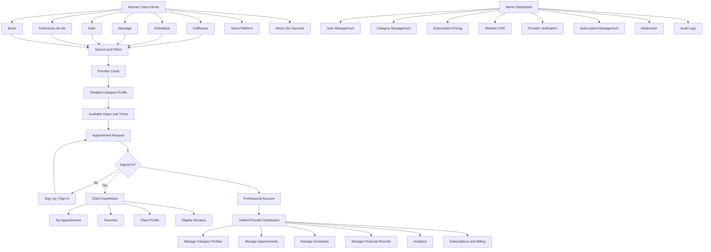

# Site map

All public routes are prefixed by the locale: `fr` (default, LTR) or `ar` (RTL). `/` redirects to the
visitor's preferred locale (saved cookie, then `Accept-Language`, then `fr`) in `src/proxy.ts`.

Owner's reference diagram: [assets/sitemap-reference.webp](assets/sitemap-reference.webp).

## Routes and implementation status

Legend: ✅ built and verified · 🚧 partially built · ⬜ not built yet.

### Public

| Route | Page | Status |
|---|---|---|
| `/[locale]` | Home | ✅ |
| `/[locale]/coiffeuses` · `esthetique` · `massage` · `nails` · `extensions-de-cils` · `botox` | Category directories | ✅ |
| `/[locale]/providers/[slug]` | Provider identity | ✅ |
| `/[locale]/profiles/[profileSlug]` | Category profile | 🚧 booking panel waits for Phase 6 |
| `/[locale]/about-platform` | About Woman Cares | ✅ |
| `/[locale]/about-services` | For professionals | ✅ |
| `/[locale]/auth/sign-in` · `/auth/sign-up` (`?role=provider`) · `/auth/check-email` · `/auth/verify-email` · `/auth/forgot-password` · `/auth/reset-password` | Authentication | ✅ |
| `/[locale]/contact` | Contact | ✅ |
| `/[locale]/legal/privacy` · `/legal/terms` | Legal | 🚧 provisional drafts until legal review |

Directory URL contract (produced by the homepage search dialog and the directory filters; parsed by `src/lib/validation/directory.ts`):
`/[locale]/[category]?wilaya=<code>&commune=<text>&q=<text>&specialty=<slug>&date=YYYY-MM-DD&minPrice&maxPrice&minExperience&minRating&verified=1&lat=<2dp>&lng=<2dp>&maxKm=5|10|25|50&sort=relevance|distance|price|price_desc|rating&page=<n>`. Invalid values are ignored rather than failing the page.
Coordinates are rounded to two decimals (~1 km) before entering the URL.

### Protected (server-side role checks; hiding a link is never the protection)

| Area | Routes | Status |
|---|---|---|
| Client | `/dashboard/client` 🚧 (guarded overview) · `/appointments`, `/favorites`, `/profile`, `/notifications`, `/settings` ⬜ | |
| Provider | `/dashboard/provider` ✅ overview · `/profiles` ✅ (list, add/archive categories) · `/profiles/[profileId]` ✅ editor (presentation, services, portfolio, hours, closures, submit) · `/settings` ✅ (business, location, visibility) · `/services` ✅ and `/schedule` ✅ (index into each profile's editor) · `/bookings`, `/analytics`, `/earnings`, `/billing`, `/notifications`, `/support` ⬜ | |
| Admin | `/dashboard/admin` 🚧 (guarded overview with live counts) · `/users`, `/providers`, `/categories`, `/pricing`, `/subscriptions`, `/payments`, `/content`, `/moderation`, `/analytics`, `/support`, `/audit`, `/settings` ⬜ | |

Access: `src/proxy.ts` sends visitors without a session cookie to sign-in (optimistic, no database).
Every dashboard page then calls `requireArea()` on the server: wrong role or suspended account → 404.

### API

`/api/v1/*`, see [API_SPECIFICATION.md](API_SPECIFICATION.md). Implemented: `POST /api/v1/profiles/{slug}/views`,
`POST /api/v1/provider/profiles/{profileId}/media`. Public media: `GET /uploads/*`.
