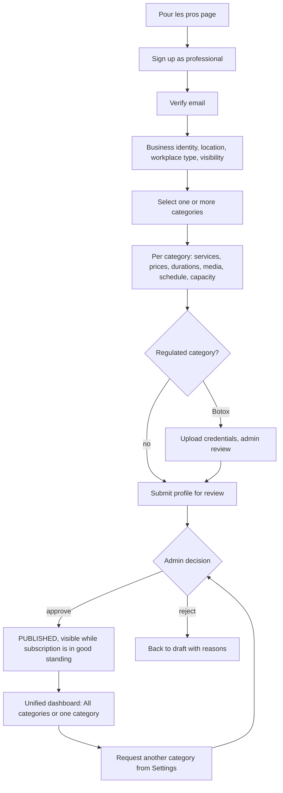
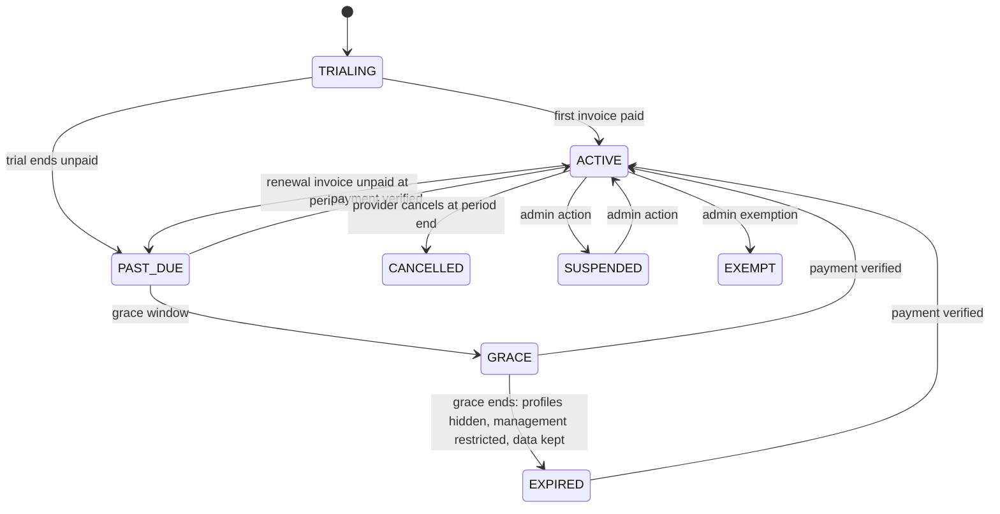
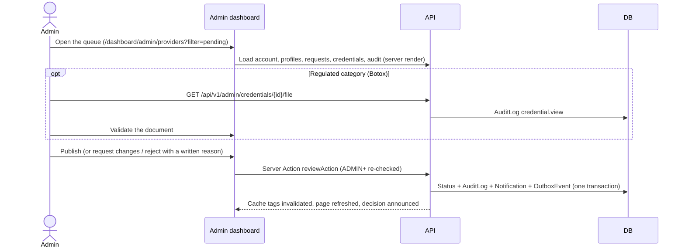

# User flows

## Client: discover and request


## Professional: onboarding and multiple categories



## Subscription lifecycle



## Admin: approve a provider



SUPPORT can open the queue and the review page but every decision button is replaced by a read-only notice,
and the server refuses the decision anyway. A change request sends the profile back to DRAFT with the note,
which the professional sees above her profile and in her email.

## Admin: schedule a subscription price

```mermaid
sequenceDiagram
    actor Admin
    participant UI as /dashboard/admin/pricing
    participant API as manageAction
    participant DB
    participant Public as Pour les pros
    Admin->>UI: Price + start day (tomorrow or later)
    UI->>API: price.add (ADMIN+ re-checked, day validated in Algiers time)
    API->>DB: New CategorySubscriptionPricing row (00:00 Africa/Algiers) + AuditLog subscription.price.schedule
    Note over DB: Existing rows are never updated
    API-->>UI: "pricing" tag invalidated; history shows the row as upcoming
    Public->>DB: getPublicPricing(today) picks the latest row starting on or before today
```

Categories follow the same pattern (`category.activate` / `deactivate` / `reorder` / `credentials.*`):
deactivation hides every profile of the category at once because public queries require an active category.
On the Users page, a suspension (written reason) or a role change signs the person out everywhere; a suspended
professional, or one moved out of the PROVIDER role, disappears from public pages until restored.

## Booking management after the request

Rules: `src/lib/booking-rules.ts`. States: [architecture/booking-state-machine.mmd](architecture/booking-state-machine.mmd).

```mermaid
sequenceDiagram
    participant C as Cliente
    participant S as Server (status-guarded writes)
    participant P as Professionnelle
    P->>S: Propose 12:00 (free slot, profile lock)
    S-->>C: Notification + email "Nouvel horaire proposé"
    Note over S: original 10:00 and proposed 12:00 both held
    C->>S: Accept
    S-->>P: "Nouvel horaire accepté" (start moves to 12:00, 10:00 freed)
    P->>S: After the visit: Terminé
    P->>S: Record 2 500 DA cash (her own bookkeeping)
    C->>S: One review (1 to 5 stars)
    Note over C,P: Either side can cancel before the start; the professional must give a reason.
```

Unanswered requests expire at `pendingExpiresAt` (48 hours or the start, whichever comes first)
when `npm run daily` runs; the client is told and the place is freed.
